# Staff Accommodation Management: application guide

A complete description of the application: what it does, who uses it, how each
person moves through it, and how it is built. Diagrams use
[Mermaid](https://mermaid.js.org) and render on GitHub.

Related documents: [README](../README.md) (rules per module, setup),
[requirements-analysis.md](requirements-analysis.md) (SRS and release plan),
[deployment.md](deployment.md) (Linux server), [architecture.md](architecture.md)
(target multi-service design).

Contents

1. [Purpose and scope](#1-purpose-and-scope)
2. [Users and roles](#2-users-and-roles)
3. [Feature map](#3-feature-map)
4. [User journeys](#4-user-journeys)
5. [Architecture](#5-architecture)
6. [Data model](#6-data-model)
7. [Status models](#7-status-models)
8. [Security model](#8-security-model)
9. [Background processing and notifications](#9-background-processing-and-notifications)
10. [Configuration and operations](#10-configuration-and-operations)
11. [Testing and CI](#11-testing-and-ci)
12. [Known gaps](#12-known-gaps)

---

## 1. Purpose and scope

The platform runs staff housing and the operations around it for an
organisation with one or more sites. It replaces spreadsheets and paper forms
with one system that:

- models the **accommodation hierarchy**: organisation → site → building → room → bed;
- **allocates** beds to staff, with check-in, check-out and transfers;
- gives residents a **mobile-first portal** for their stay, requests and tickets;
- runs **digital forms with multi-level approval**;
- handles **maintenance** work orders with SLAs and contractor access;
- manages **facility booking**, the **key register**, **inventory** and **lost and found**;
- sends **in-app, email and WhatsApp** notifications and **broadcasts**;
- provides a **dashboard, reports and CSV export**, bulk **import**, and an **audit log**.

It is a modular monolith: one Next.js application and one PostgreSQL database,
plus a delivery worker. Business rules that must hold under concurrency are
enforced in the database as well as in code.

---

## 2. Users and roles

Ten roles exist (`Role` enum). A user can hold several, each optionally scoped
to a site or building.

| Role | Who | Main capabilities |
|------|-----|-------------------|
| `SYSTEM_ADMIN` | IT / platform owner | Everything; users, roles, audit, configuration |
| `ACCOMMODATION_ADMIN` | Head of accommodation | Manage hierarchy, allocations (incl. cancel, override), forms, imports, lost-and-found disposal |
| `ACCOMMODATION_OFFICER` | Reception / front desk | Allocate, check in/out, transfer, issue keys, coordinate maintenance, broadcasts |
| `STAFF` | Resident | Own stay, requests, tickets, facility bookings, claims |
| `APPROVER` | Line manager etc. | Decide approval steps, set delegations |
| `MAINTENANCE` | In-house engineer | Work only tickets assigned to them |
| `VENDOR` | Contractor technician | Tickets of their vendor only; access can expire |
| `INVENTORY_KEY_CUSTODIAN` | Store / key keeper | Keys, inventory, lost-and-found operations |
| `FACILITY_MANAGER` | Gym/hall manager | Facility settings, approvals, attendance |
| `AUDITOR` | Compliance | Read-only access to reports and logs; employee IDs, no names |

A user holding **only** `STAFF` is a resident: sign-in lands on `/my` and the
staff sidebar is hidden. Everyone else sees a role-filtered sidebar built from
`apps/web/src/components/shell/nav.ts`, using the same role lists the pages
enforce.

Role lists live in each module's `access.ts` under `packages/core/src/modules/`.

---

## 3. Feature map

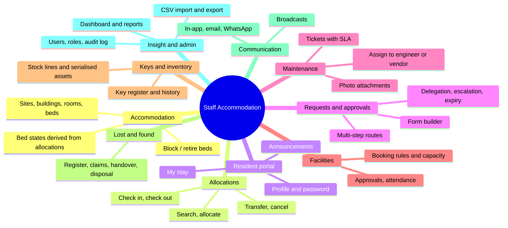

| Area | Staff-facing pages | Back-office pages |
|------|-------------------|-------------------|
| Accommodation | `/my/stay` | `/accommodation`, `/accommodation/buildings/:id`, `/accommodation/rooms/:id` |
| Allocations | `/my` (pending actions) | `/accommodation/allocations`, `/new`, `/:id`, `/:id/transfer` |
| Requests | `/my/requests`, `/my/requests/new/:typeCode` | `/approvals`, `/approvals/:id`, `/approvals/delegations`, `/admin/forms` |
| Maintenance | `/my/maintenance` | `/maintenance`, `/maintenance/new`, `/maintenance/:id` |
| Facilities | `/my/facilities` | `/facilities`, `/facilities/:id` |
| Keys | keys held shown in `/my/stay` | `/keys`, `/keys/:id` |
| Inventory | items held shown in `/my/stay` | `/inventory`, `/inventory/:id`, `/inventory/reports` |
| Lost & found | `/my/lost-found` | `/lost-found`, `/lost-found/:id` |
| Communication | `/my/announcements` | `/admin/broadcasts`, `/admin/notifications` |
| Insight | | `/dashboard`, `/reports/*`, `/search` |
| Administration | `/my/profile` | `/admin/users`, `/admin/audit`, `/admin/import` |

---

## 4. User journeys

### 4.1 Sign-in and landing (all users)

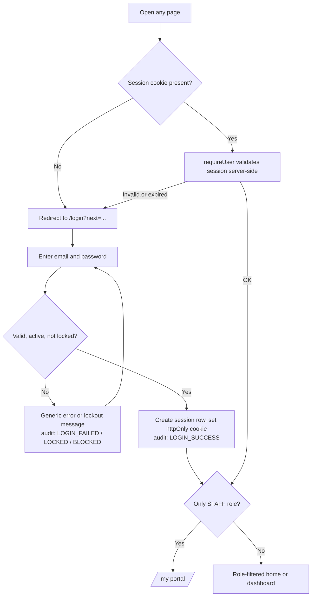

New users arrive through an invitation link (`/invite/:token`): the link sets
the password, activates the account and ends other sessions.

### 4.2 Resident: arrive, live, request, leave

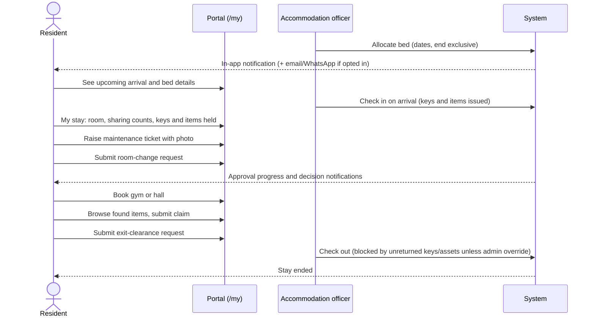

Steps in the portal:

1. **Home (`/my`)**: current bed, pending actions (arrival, booked move, stay ending within 14 days), notifications.
2. **Stay (`/my/stay`)**: building/room/bed, dates, sharing (counts only), next bed if a transfer is booked, keys and items held, previous stays.
3. **Profile (`/my/profile`)**: edit phone and emergency contact, change password (signs out other sessions), email and WhatsApp preferences with explicit consent.
4. **Requests, maintenance, facilities, lost and found, announcements**: each has list, new and detail pages.

### 4.3 Reception: allocate, check in, transfer, check out

```mermaid
stateDiagram-v2
    [*] --> CONFIRMED: Allocate (one bed per person,<br/>no overlap, gender policy)
    CONFIRMED --> CHECKED_IN: Check in<br/>(early arrival moves start date)
    CONFIRMED --> CANCELLED: Cancel (admin, reason)
    CHECKED_IN --> CHECKED_OUT: Check out<br/>(keys/assets cleared or admin override)
    CONFIRMED --> CONFIRMED: Transfer before arrival<br/>(allocation replaced, linked)
    CHECKED_IN --> CHECKED_IN: Same-day transfer moves resident now;<br/>future-dated keeps bed until effective date
    CHECKED_OUT --> [*]
    CANCELLED --> [*]
```

1. `/accommodation/allocations/new`: search beds by dates, building, gender policy; pick a staff member; allocate.
2. Allocation detail: check in, issue keys and items, check out, cancel, or transfer (`/transfer`).
3. Database guard: an exclusion constraint prevents two confirmed or checked-in allocations overlapping on one bed, even under races.

### 4.4 Request with multi-level approval

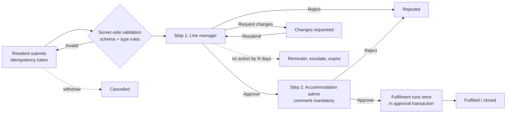

- Approvers must hold the step's role and cannot decide their own request.
- Delegates can decide for an absent approver; the history records who acted for whom.
- Fulfilment: visitor and family requests complete on approval; exit clearance sets the allocation end date; an approved room change is completed when an officer performs the transfer.
- The request pins the workflow version current at submission, so form edits never change in-flight requests.

### 4.5 Maintenance ticket

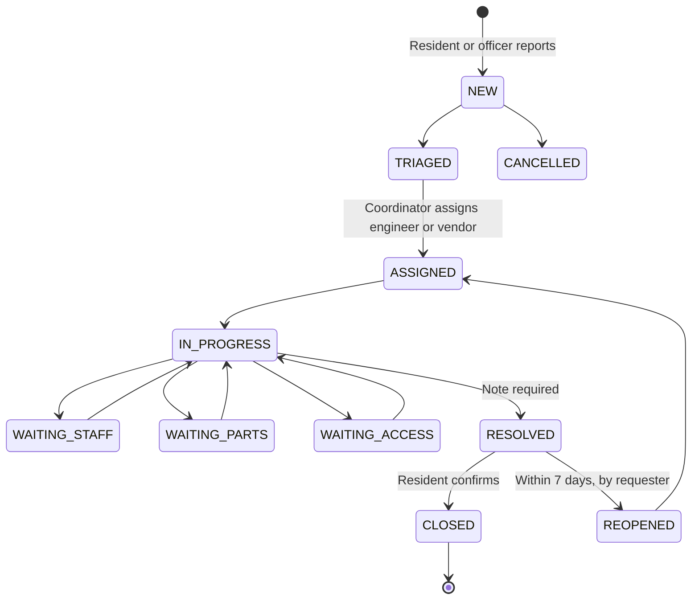

SLA targets: urgent 4 h, high 24 h, medium 72 h, low 168 h. Engineers and
vendors see only tickets assigned to them; internal notes are hidden from
residents and vendors.

### 4.6 Facility booking

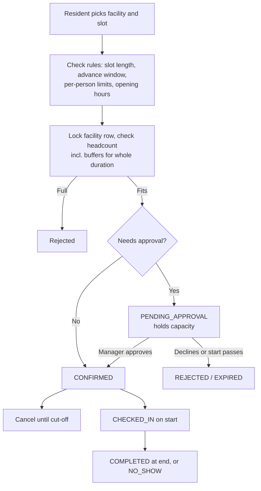

### 4.7 Keys, inventory, lost and found (custodian / reception)

- **Keys:** register per room or facility → issue to resident or named outsider (one open issue per key, enforced by a partial unique index) → return with condition → damaged goes to repair; lost stays against the holder so check-out clearance still flags it → replacement retires the old key.
- **Inventory:** stock lines (counted, reorder threshold) and serialised assets (one place at a time). Every change is a logged movement; issues run under a row lock and the database refuses negative stock.
- **Lost and found:** found item gets `LF-nnnnnn` and a retention date → claims from residents or walk-ins → staff verify or reject → handover with evidence → disposal only by an admin after retention expires with no pending claim.

### 4.8 Administrator

1. **Users (`/admin/users`)**: create invited user with scoped roles → link to staff record or vendor → suspend/deactivate with reason (ends sessions at once). The last active system admin cannot be removed.
2. **Forms (`/admin/forms`)**: build fields and conditional visibility, define approval route, preview, publish as a new version; set reminder/escalation/expiry policy.
3. **Import (`/admin/import`)**: upload CSV → preview every row (create/update/unchanged/error) → import in one transaction.
4. **Broadcasts, notifications, audit, reports**: send announcements to filtered audiences, monitor delivery and retry failures, search the audit log, export CSV (each export is audited).

---

## 5. Architecture

### 5.1 Current deployment shape

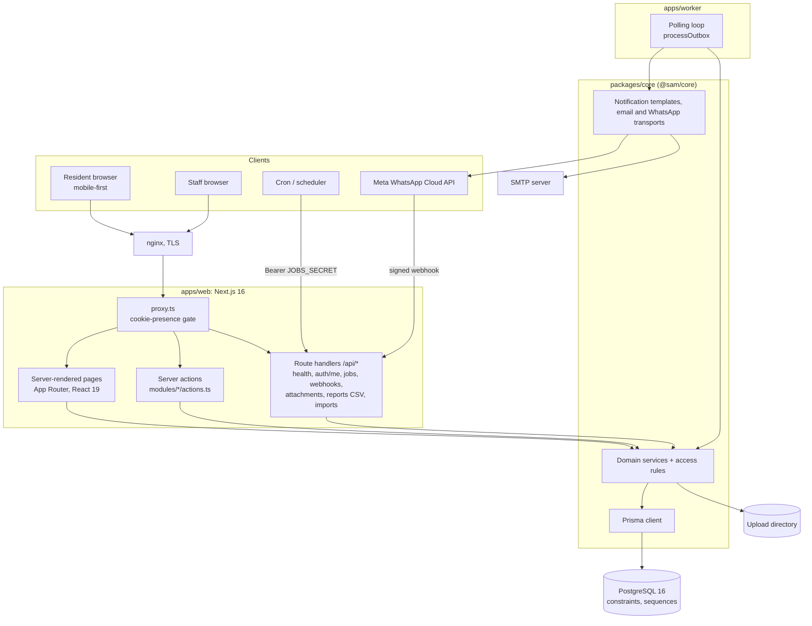

| Workspace | Package | Role |
|-----------|---------|------|
| `apps/web` | `@sam/web` | UI and HTTP edge: pages, server actions, route handlers, session cookie handling, role-gated navigation |
| `apps/worker` | `@sam/worker` | Long-running outbox delivery loop (email, WhatsApp), polling every `EMAIL_WORKER_INTERVAL_SECONDS` |
| `packages/core` | `@sam/core` | Prisma schema and migrations, seed, framework-free domain services, access role lists, notification rendering and transports, upload handling, tests |
| `scripts/jobs.mjs` | | Cron helper: calls `POST /api/jobs/notifications` |

> **Target vs. current.** [architecture.md](architecture.md) describes a future
> split with a separate Fastify `apps/api` service and `packages/contract`.
> That service does not exist yet: the web app calls `@sam/core` directly. The
> `dev:api` and `start:api` scripts in the root `package.json` refer to the
> unbuilt `@sam/api` workspace.

### 5.2 Layering inside a module

Each feature (allocations, maintenance, keys and so on) follows the same shape:

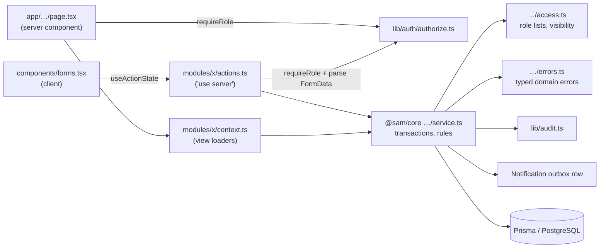

Principles:

- **Services own the rules.** Pages and actions only authenticate, parse input and call a service. Services run each business operation in one transaction, write an `AuditEvent`, and queue notifications in the same transaction.
- **Typed errors** (`errors.ts`) map to user-facing messages in actions.
- **Pure access modules** make role lists reusable by navigation, pages and services.
- **Idempotency keys** on requests, bookings and notifications make retried submissions safe.

### 5.3 Request lifecycle

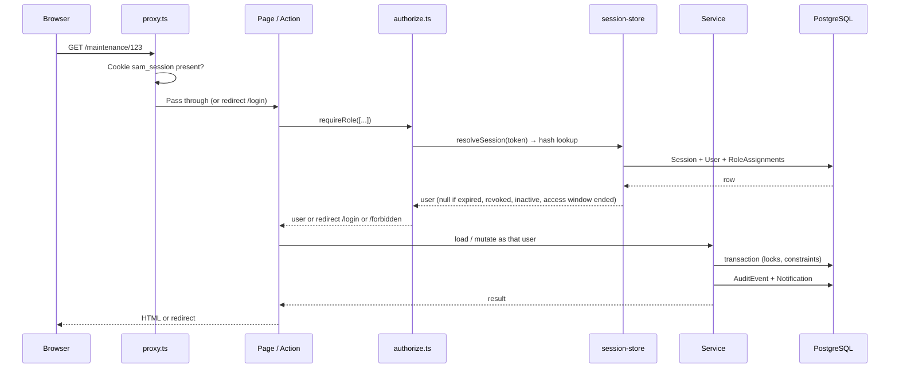

### 5.4 Route handlers

| Route | Auth | Purpose |
|-------|------|---------|
| `GET /api/health` | public | Liveness plus database check |
| `GET /api/auth/me` | session | Current user and role assignments |
| `POST /api/jobs/notifications` | `Authorization: Bearer JOBS_SECRET` (constant-time compare) | Process outbox, sweep bookings (expire/complete), sweep requests (remind/escalate/expire) |
| `GET/POST /api/webhooks/whatsapp` | verify token (GET), HMAC `X-Hub-Signature-256` (POST) | Meta handshake and delivery receipts |
| `GET /api/attachments/:id` | session + per-record access check | Serve uploaded photos |
| `GET /api/reports/*.csv` | session + reporting role | CSV exports (audited) |
| `GET /api/imports/:kind.csv` | session + import role (system/accommodation admin) | Export current data in import layout, or `?template=1` example file (preview and commit run as server actions on `/admin/import`) |

### 5.5 Frontend

- Next.js App Router with server components by default; client components only for forms and interactive widgets.
- Tailwind CSS 4 with design tokens and component classes in `globals.css` (deep-green sidebar shell, validated chart palette with light and dark steps).
- Shell: `app-shell.tsx`, `sidebar-nav.tsx`, `page-header.tsx`; residents get a separate layout under `/my` with a bottom tab bar.
- Global search at `/search` across people, beds and tickets.

---

## 6. Data model

Defined in `packages/core/prisma/schema.prisma` (about 1,150 lines, 19
migrations). Core relationships:

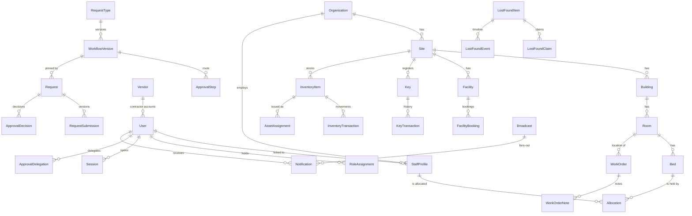

Cross-cutting tables: `Attachment` (polymorphic `entityType`/`entityId`),
`Notification` (outbox and in-app, with channel, status, attempts, idempotency
key), `AuditEvent` (append-only), `ImportBatch`.

### Integrity enforced in PostgreSQL

| Rule | Mechanism |
|------|-----------|
| A bed cannot be double-allocated | `EXCLUDE USING gist` on bed + date range for `CONFIRMED`/`CHECKED_IN` |
| End date not before start date | `CHECK` on `Allocation` |
| Room and facility capacity positive | `CHECK (capacity > 0)` |
| Booking end after start, headcount positive | `CHECK` on `FacilityBooking` |
| One open issue per key | partial unique index `KeyTransaction_one_open_issue` |
| One open assignment per serialised asset | partial unique index `AssetAssignment_one_open_assignment` |
| Stock never negative | `CHECK (quantity >= 0)` |
| Asset assigned to exactly one place | `CHECK` over room/staff/facility columns |
| One stock line per SKU per site; unique serials | partial and plain unique indexes |
| Audit log append-only | trigger `AuditEvent_immutable` rejects UPDATE and DELETE |
| Duplicate submissions | unique idempotency keys on request, booking, notification |
| Ticket numbers `MR-<year>-<n>` | database sequence |

---

## 7. Status models

| Entity | States |
|--------|--------|
| Allocation | DRAFT, PENDING_APPROVAL, CONFIRMED, CHECKED_IN, CHECKED_OUT, CANCELLED, REJECTED, EXPIRED |
| Bed (derived) | Occupied, Allocated awaiting check-in, Vacant, Blocked, Retired |
| Request | DRAFT, SUBMITTED, PENDING_APPROVAL, CHANGES_REQUESTED, RESUBMITTED, APPROVED, REJECTED, FULFILLED, CLOSED, CANCELLED, EXPIRED |
| Approval decision | APPROVE, REJECT, REQUEST_CHANGES |
| Work order | NEW, TRIAGED, ASSIGNED, IN_PROGRESS, WAITING_STAFF, WAITING_PARTS, WAITING_ACCESS, RESOLVED, CLOSED, REOPENED, CANCELLED |
| Booking | PENDING_APPROVAL, CONFIRMED, CHECKED_IN, COMPLETED, CANCELLED, REJECTED, EXPIRED, NO_SHOW |
| Key | AVAILABLE, ISSUED, LOST, DAMAGED, UNDER_REPAIR, RETIRED |
| Lost and found item | REPORTED, STORED, CLAIM_PENDING, RETURNED, DISPOSED |
| Broadcast | DRAFT, SENT, CANCELLED |
| Import batch | PREVIEW, IMPORTED, DISCARDED |
| Notification | QUEUED, SENT, DELIVERED, FAILED (channels IN_APP, EMAIL, WHATSAPP) |

---

## 8. Security model

| Concern | Implementation |
|---------|----------------|
| Passwords | scrypt, self-describing hash string so parameters can be raised later |
| Sessions | Random 32-byte token; only its SHA-256 is stored; `HttpOnly`, `SameSite=Lax`, `Secure` in production; absolute TTL `SESSION_TTL_HOURS` (12); `lastSeenAt` touched every 5 min |
| Immediate revocation | Deactivated, suspended or access-expired users resolve to no session on the next request; `revokeUserSessions` ends all sessions |
| Brute force | Lockout after 5 failures for 15 minutes; unknown email runs a dummy hash to equalise timing; all outcomes audited |
| Authorisation | Layered: `proxy.ts` (cookie present) → `requireUser`/`requireRole` in every page and action → per-record checks in services (`accessFor`, scope filters) |
| Scope | Role assignments can be global, site or building scoped; reports return empty for out-of-scope sites; auditors see employee IDs, not names |
| Open redirects | `safeReturnPath` accepts only same-app relative paths |
| Uploads | Magic-byte validation (JPEG, PNG, WebP), 5 MB cap, random storage keys, path-prefix check on read, served only through an access-checked route |
| Machine endpoints | Jobs: bearer secret with constant-time compare. WhatsApp: HMAC signature, rejected when the secret is unset |
| Invites and resets | One-time links with expiry; only the token hash is stored |
| Privacy | Residents never see other residents' details; claimant details and storage locations are visible to lost-and-found staff only; WhatsApp requires timestamped consent and carries no room codes or tokens |
| Audit | Every sign-in event, privileged change and export writes an `AuditEvent` with actor and before/after values |

---

## 9. Background processing and notifications

Business actions never send messages directly. They write a `Notification` row
in the same transaction; delivery is separate, so a mail failure cannot undo an
allocation or approval.

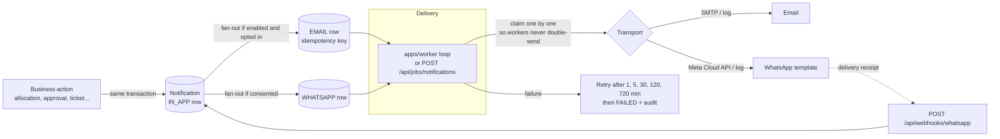

The jobs endpoint also runs two sweeps:

- **`sweepBookings`**: expires pending bookings whose start has passed and completes used bookings at their end time.
- **`sweepRequests`**: sends step reminders, escalates to the configured role, and expires stale requests according to each request type's policy.

Run delivery either with the long-running worker (`npm run start:worker`) or a
once-a-minute cron calling `npm run jobs`.

---

## 10. Configuration and operations

Settings come from environment variables (see `.env.example`).

| Group | Keys |
|-------|------|
| Database | `DATABASE_URL` |
| Auth | `SESSION_TTL_HOURS`, `LOGIN_MAX_FAILED_ATTEMPTS`, `LOGIN_LOCKOUT_MINUTES`, `INVITE_TTL_HOURS`, `RESET_TTL_HOURS`, `SEED_PASSWORD` |
| Uploads and domain | `UPLOAD_DIR`, `MAX_UPLOAD_BYTES`, `MAINTENANCE_REOPEN_WINDOW_DAYS`, `LOST_FOUND_RETENTION_DAYS` |
| Email | `EMAIL_TRANSPORT` (smtp/log/disabled), `SMTP_*`, `MAIL_FROM`, `EMAIL_FANOUT`, `EMAIL_MAX_ATTEMPTS`, `EMAIL_WORKER_INTERVAL_SECONDS`, `APP_BASE_URL` |
| WhatsApp | `WHATSAPP_TRANSPORT` (meta/log/disabled), `WHATSAPP_ACCESS_TOKEN`, `WHATSAPP_PHONE_NUMBER_ID`, `WHATSAPP_VERIFY_TOKEN`, `WHATSAPP_APP_SECRET`, `WHATSAPP_FANOUT`, `WHATSAPP_LANGUAGE`, `WHATSAPP_TEMPLATE_PREFIX`, `WHATSAPP_TEMPLATE_MAP`, `DEFAULT_COUNTRY_CODE` |
| Scheduler | `JOBS_SECRET`, `JOBS_URL` |

Typical production topology (see [deployment.md](deployment.md)):

1. nginx terminates TLS and proxies to Next.js under PM2.
2. PostgreSQL 16 on the same or a separate host, with backups.
3. `UPLOAD_DIR` on persistent storage.
4. Cron runs `npm run jobs` every minute (or the worker process runs continuously).
5. `GET /api/health` is the health check.

Local development:

```bash
cp .env.example .env
docker compose up -d db
npm install
npm run db:deploy && npm run db:seed
npm run dev          # http://localhost:3000
```

Demo accounts (password `ChangeMe123!`): `admin@`, `officer@`, `staff@`,
`manager@`, `engineer@`, `vendor@`, `custodian@`, `facility@`, `auditor@`
`example.com`.

---

## 11. Testing and CI

- **Unit and integration tests:** Vitest in `packages/core/tests/` (about 21 files covering admin users, allocations, broadcasts, delegations, facilities, form builder, imports, inventory, keys, lost and found, and more). They run against a real PostgreSQL so the database constraints are exercised.
- **CI** (`.github/workflows/ci.yml`): Postgres 16 service → `npm ci` → lint → typecheck → migrate → seed → test → build.
- **Not covered:** the web app has no automated tests of its own (server actions, route handlers, `authorize.ts`).

---

## 11a. Roles, permissions and module map (implemented)

The platform follows "Staff Accommodation Platform – Roles, Permissions & Module Map". The delivered scope, by phase:

1. **Permission engine** – one matrix (`lib/permissions/matrix.ts`) of modules × ten roles with default/grantable/locked/view/own cells, named capability sets, per-user and per-role grants, maker-checker for sensitive changes (including retention), username login.
2. **Role homes and privacy** – per-role dashboards and navigation, masked personal data, watermarked exports, soft delete and a 30-day archive with restore.
3. **People and stay lifecycle** – staff directory, verification, joiners/exits, floors and units, emergency (provisional) check-in, extensions, swaps, bulk allocation, accommodation waitlist.
4. **Maintenance, keys, inventory** – triage board, cost approvals, permits, preventive plans, vendors, key loss and audit, stock write-offs.
5. **Security, housekeeping, charges** – visitor approval and gate flow, patrol, restricted list, SOS; housekeeping rounds; charges with vendor recovery.
6. **Reporting and governance** – report layers L1–L4, KPI dictionary with targets, scheduled reports, signed webhooks and API keys, retention policies, DPDP consent and data requests, audit context.
7. **Approval routing** – steps scoped to the requester's or target site, a different approver per step, Super Admin stand-in; inter-site transfer, extension (within/beyond policy) and eligibility-exception request types.
8. **Facilities** – closures, event blocks, recurring reservations, eligibility rules, fees, no-show strikes with lift, booking waitlist with timed offers (`sweepWaitlist`), who-booked view.

Daily sweeps (`modules/jobs/daily.ts`) include provisional check-ins, profiles, joiners, exits, work-order auto-close, preventive, vendors, visitors, inspections, scheduled reports, alerts, retention, webhooks, bookings, requests and the facility waitlist.

## 12. Known gaps

From the README and code review:

- Password reset by the user and account recovery (SRS SS-08); SSO and MFA are not implemented.
- Role checks are not yet scoped per site everywhere.
- The separate API service in [architecture.md](architecture.md) is a plan, not implemented; remove or implement the `@sam/api` scripts.
- Login lockout can be triggered by anyone against a known account, and the lockout message reveals that an account exists.
- `x-forwarded-for` is stored as the session IP without verifying a trusted proxy.
- `/api/jobs/notifications` does not clamp its `limit` parameter.
- No web-layer tests.
